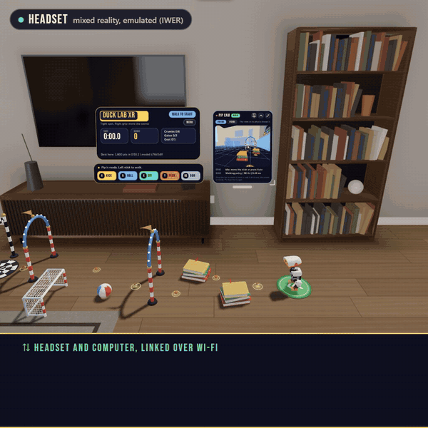
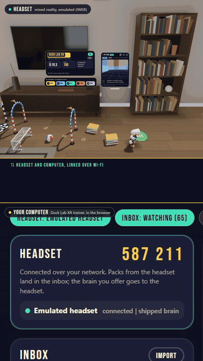
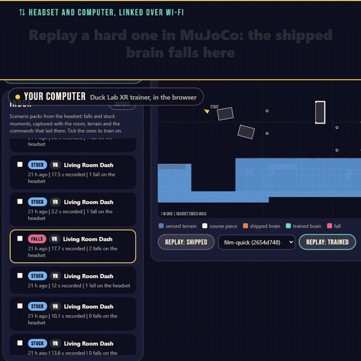
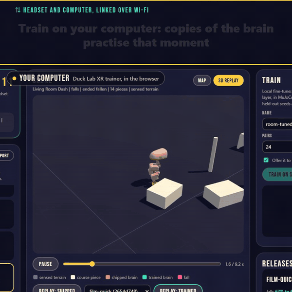
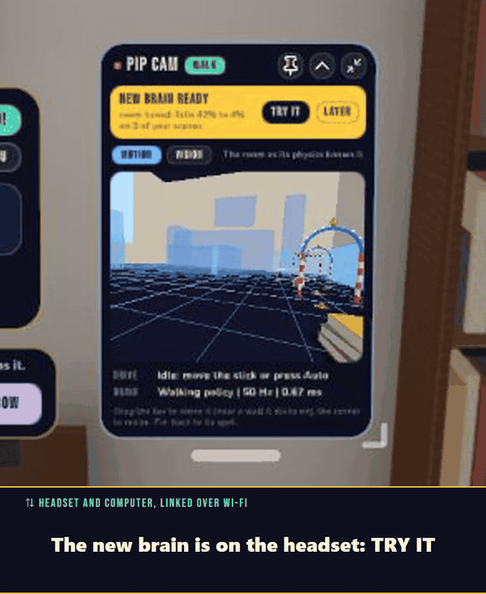

# Duck Lab XR

Train a robot duck in your own room. Duck Lab XR is a mixed-reality game and
training lab for [Pollen Robotics](https://www.pollen-robotics.com/)'
Microduck, a 25 cm walking robot duck. On a Meta Quest, a simulated Microduck
walks on your real floor, bumps into your real furniture and runs obstacle
courses around your room. The moments where it falls become training scenes,
a trainer on your computer makes its walking brain better at your room, and
the improved brain goes back to the headset, or onto a real duck.

The duck's name is Pip.

<p align="center">
  
  <br>
  <sub>Pip in mixed reality, recorded in IWER, Meta's headset emulator</sub>
</p>

> Duck Lab XR is an independent fan project, not made or endorsed by Pollen
> Robotics. The duck's meshes are licensed CC BY-NC-SA 4.0, so the app is for
> non-commercial use (see [Licence](#licence)).

## Features

- **Real robot physics and brains.** MuJoCo (WebAssembly) simulates the duck
  at 50 Hz with Pollen's own trained policies (ONNX), all in the browser.
- **Your room is the level.** Plane, mesh and depth sensing give the duck
  your floor, walls and furniture to walk on and bump into.
- **Playgrounds.** Living Room Dash and Sneaker Alley (in your room, or in a
  VR toy room), Backyard (VR) and Your Room (free roam in mixed reality).
  Moves: kick, roll, sit, peck and bow. An editor lets you drag, turn, add
  and remove course pieces, keep your own board and share it as a link.
- **Pip cam.** A panel shows what the duck's head camera sees: the room as
  its physics knows it (MOTION), or a camera view with every object in sight
  labelled (VISION), plus sensor and motor details.
- **A trainer on your computer.** Falls and stuck moments go to the trainer
  as test cases. It replays them in MuJoCo, fine-tunes the walking policy on
  them in minutes on a CPU, and offers the new brain to the headset, which
  swaps it in while the duck keeps walking.
- **One-tap pairing.** Headset and computer open the same website; after one
  tap they talk directly over WebRTC on your home network.
- **Export anywhere.** Test cases go out as MuJoCo scenes of your room,
  meshes for other engines, recorded runs and a Python environment, for
  MuJoCo, mjlab, Isaac, Genesis or Gymnasium.
- **A real Microduck.** Drive your duck from the game and install a brain
  trained in Duck Lab XR on it, through Pollen's remote-access service.

## Play it

Open **https://duck.bruna.world** in the browser of a Meta Quest 3 and
press **ENTER MR** in the menu (or **ENTER VR** for the toy room). It also runs
in a desktop browser, where W A S D walk the duck, and on a phone, where an
on-screen stick does. The hosted site counts
visits with Vercel Web Analytics, which sets no cookies.

To train Pip on your room you also need the trainer engine on your computer:
Node.js 22.12 or newer, this repository, then `npm install` and `npm run lab`
(see [Training Pip on your room](#training-pip-on-your-room)).

## Run it locally

You need Node.js 22.12 or newer (see `.nvmrc`; 20.19+ and 24 also work).

```sh
npm install
npm run dev    # dev server, plus a browser window with a headset emulator
npm run lab    # the trainer engine on http://localhost:8790 (for training)
```

`npm run dev` serves the game at https://localhost:8081/ and opens it in a
managed browser with an emulated headset (IWER), so no headset is needed. To
try it on a Quest on the same Wi-Fi, open the network address that
`npx @iwsdk/cli dev status` prints in the Quest browser, accept the local
certificate warning, and press **ENTER MR**.

## Playing

| | Headset | Desktop and phone |
| --- | --- | --- |
| Walk and turn | left stick | W A S D or arrows; the on-screen stick on a phone |
| Look around | your head | drag the room (mouse or finger); the wheel or a pinch zooms |
| Kick, roll, sit, peck | A, B, X, Y | J, K, L, I, or the menu's **MOVES** |
| Bow | right stick click | N, or the menu |
| Restart the run | left grip | R, or the menu's **RESTART** |
| Autopilot (run the course) | menu, **AUTO** | P |
| Save this moment as a test case | automatic after falls | X |
| Menu | left stick click, or the scoreboard's MENU chip | always shown on a wide window; M or the MENU chip on a small one |

On a phone or a desktop, the scoreboard, the menu and Pip cam each fold away
with their minimize buttons. The menu has the moves (on a phone or a
desktop), the playgrounds, the autopilot, Pip cam, the course editor
(**EDIT**), **CONTROLS** (the how-to-play card), pairing with the trainer and
the real duck. In the editor, point at a piece and hold the trigger (or the
mouse button) to slide it; the thumbstick (or Q / E) turns it and B (or
Delete) removes it.

## Training Pip on your room

<table>
  <tr>
    <td align="center" width="50%">
      
      <br><sub>A hard moment goes to the computer as a test case</sub>
    </td>
    <td align="center" width="50%">
      
      <br><sub>Replayed in MuJoCo, the shipped brain falls there too</sub>
    </td>
  </tr>
  <tr>
    <td align="center">
      
      <br><sub>Training on that moment, on the computer's CPU</sub>
    </td>
    <td align="center">
      
      <br><sub>The new brain arrives on the headset: TRY IT</sub>
    </td>
  </tr>
</table>

1. **Play.** When Pip falls twice within 20 seconds, or the autopilot is stuck
   for 8 seconds, the headset saves that moment as a test case: the room
   scan, the terrain, the duck's state and every command that led there.
2. **Open the trainer.** Start the trainer engine on the computer
   (`npm run lab` in this repository), then open the site there and click
   **TRAINER** at the top (https://duck.bruna.world/trainer/; in
   development https://localhost:8081/, where **Start the trainer** starts the
   engine for you). When the browser asks whether the site may connect to
   apps on this device, allow it: that is how the page reaches the engine.
   The page shows a six-digit code.
3. **Pair.** On the headset, open the same site, then the menu, **TRAINER ON
   YOUR COMPUTER**, and tap **PAIR** next to that code. From then on, test
   cases go up to the trainer by themselves, and the headset reconnects
   whenever the trainer page is open. **FORGET** unpairs.
4. **Train.** In the trainer's inbox, replay a test case in MuJoCo to see the
   shipped brain fall, tick the cases to train on, and **TRAIN ON SELECTED**.
   The fine-tune learns a small change to the walking policy with evolution
   strategies, shoves and noise, then checks it on held-out runs and plain
   floor.
5. **Try it.** **SEND TO HEADSET** offers the new brain: Pip cam shows "New
   brain ready", and **TRY IT** swaps it in without a reload. **REVERT** on
   Pip cam goes back to the shipped brain.

No server of ours is involved. The headset and the trainer page find each
other through public Nostr relays with [trystero](https://github.com/dmotz/trystero):
each learns its home's public address from a STUN server and joins a lobby
named after it, so only devices on the same network meet there. Pairing hands
the headset the trainer's own room, a secret that also encrypts the handshake;
from then on the two talk directly over WebRTC on your home network
(`src/link/`). The relays only ever carry a few bytes of handshake. The
trainer engine listens on 127.0.0.1 only and answers only its own page and
the Duck Lab XR site.

The trainer can also publish a brain to the Hugging Face Hub (needed for a
real duck) and export test cases for other simulators: MuJoCo scenes of
your room, meshes for other engines, the recorded runs, the policies and a
Python environment, in one .zip, for MuJoCo, mjlab, Isaac, Genesis or
Gymnasium. Brains trained elsewhere come back as a release folder. How the
trainer works, its command-line tools and the export formats:
[tools/train/README.md](tools/train/README.md).

## A real Microduck

Duck Lab XR can drive a real Microduck and install a brain on it through
Pollen's own remote-access service, so the duck needs no changes. In the
menu, under **REAL DUCK**:

| Button | What happens |
| --- | --- |
| LINK | Signs in with your Hugging Face token and connects to the first duck online on your account. |
| MIRROR | The real duck copies the game: the stick drives it, and moves become the duck's own tricks. |
| FLASH BRAIN | The duck downloads the brain the game is running (published to the Hugging Face Hub from the trainer) and walks with it. |
| STOP WALKING | Stops the duck and the mirroring. **Not an emergency stop**: use the duck's own button for that. |

To set it up, sign the duck in to your Hugging Face account with Pollen's
app, make a new access token for Duck Lab XR (do not reuse the duck's own
token), close Pollen's console for the duck, then LINK and paste the token.
The token stays in that browser tab only. Clear the floor and stay within
reach of the duck's stop button: a trained brain has only been trained in
simulation, so try it on Pollen's simulated duck first.

This has been tested against a stand-in service with a simulated duck, not
yet with a physical one.

## Development

This is an [IWSDK](https://iwsdk.dev) (Immersive Web SDK) app, and several
things do not work like a plain Vite project: `iwsdk.config.json`, not
`vite.config.ts`, holds the scene and XR settings, Three.js is imported from
`@iwsdk/core`, and the dev server is started through the IWSDK CLI. Read
[AGENTS.md](AGENTS.md) before changing the app. The project runs on IWSDK
1.1.0-rc.1, whose emulator has photoreal rooms.

| Folder | What is in it |
| --- | --- |
| `src/` | The app: the duck's simulation (`duck/`), the room scan and terrain (`room/`), autopilot (`nav/`), courses and playgrounds, test cases and brains (`training/`), pairing (`link/`), the real duck (`robot/`) and the panels (`ui/`) |
| `public/` | Models, the Microduck asset pack, Pollen's policies, scenes, UI panels (`ui/*.uikitml`), fonts and textures |
| `tools/lab/` | The trainer engine and its page |
| `tools/train/` | Fine-tuning, replay, releases, Hub publishing and export |
| `tools/test/` | Scripted checks against the dev server, and stand-ins for Pollen's service and the Hub |
| `tools/film/` | Recording the demo films |
| `tools/assets/` | Asset pipeline (Poly Haven downloads, Google Scanned Objects conversion) |

### Checks

```sh
npm run typecheck
npm run build
```

The scripted checks drive the app in the managed browser. Start the dev
server with `npx @iwsdk/cli dev up --headed --open --allow-browser-automation`,
then:

```sh
bash tools/test/all.sh                   # every emulator check (about 20 min)
bash tools/test/mr.sh tools/test/terrain-check.mjs  # depth sensing and the room scan as solid ground, in emulated mixed reality
node tools/test/layout-check.mjs         # the 2D page: no overlapping panels at 13 window sizes, phones included
node tools/test/orbit-check.mjs          # the 2D page: dragging the room turns the camera (mouse, wheel, finger)
node tools/test/pair-check.mjs           # headset and trainer pair over WebRTC: test case up, brain down, reconnect
node tools/test/views-check.mjs          # the desktop PLAY | TRAINER switch
node tools/test/desktop-ui-check.mjs     # the how-to-play card and the folding menu
node tools/test/export-check.mjs         # the trainer's export for other simulators
node tools/test/hub-publish-check.mjs    # publishing to a stand-in Hugging Face Hub
node tools/test/trainer-start-check.mjs  # "Start the trainer" (with the engine stopped)
```

Development builds read a few URL flags: `?unpair` (forget the paired
trainer), `?pairCode=<6 digits>` (pair by code), `?acceptBrain` (take an
offered brain at once), `?packAfter=<s>` (run the course and save a test case
that many seconds after waking), `?demoReset=1` (forget the chosen and
dismissed brains) and `?lab=1` (the lab panel and telemetry);
`localStorage['ducklab.autoPacks'] = '0'` turns off automatic test cases. In
any build, `?duck=lite` loads a lighter duck mesh.

### Demo films

```sh
bash tools/test/demo-e2e.sh                  # the real -> sim -> real film -> artifacts/video/e2e.mp4
bash tools/film/stack/stack.sh               # headset on top, trainer page below, in sync -> artifacts/video/stack.mp4
node tools/film/trailer/compose-trailer.mjs  # the 1080x1920 trailer -> artifacts/video/trailer.mp4
```

The films need the dev server and the trainer engine, and leave both as they
found them. The trailer adds concept clips rendered in Blender (frames in
`artifacts/video/concept/`, made outside this repository) and an original
score synthesized in code. Recordings go to `artifacts/`, which is not
committed. They need ffmpeg: set `FFMPEG`, or install `ffmpeg-static`
(`npm install --no-save ffmpeg-static`).

## Contributing

Contributions are welcome: see [CONTRIBUTING.md](CONTRIBUTING.md) and the
[Code of Conduct](CODE_OF_CONDUCT.md). Report security problems privately,
as [SECURITY.md](SECURITY.md) describes.

## Licence

Copyright 2026 BRUNA GOODS LLC. The code is licensed under the
[Apache License 2.0](LICENSE). The parts that came from Meta's IWSDK starter
template stay under the MIT License, as [NOTICE](NOTICE) lists.

The bundled assets keep their own licences, listed in [CREDITS.md](CREDITS.md).
Most importantly, the Microduck meshes by Pollen Robotics are licensed
CC BY-NC-SA 4.0: the app as published with them is for non-commercial use,
and adapted meshes must be shared under the same licence. Pollen's policies
are Apache-2.0, the household objects CC BY 4.0, and the props and textures
CC0.

"Microduck" and "Pollen Robotics" are Pollen Robotics' names, used here only
to say what the app works with.

---

Duck Lab XR is developed by Bruna Worlds. Copyright 2026 BRUNA GOODS LLC.
